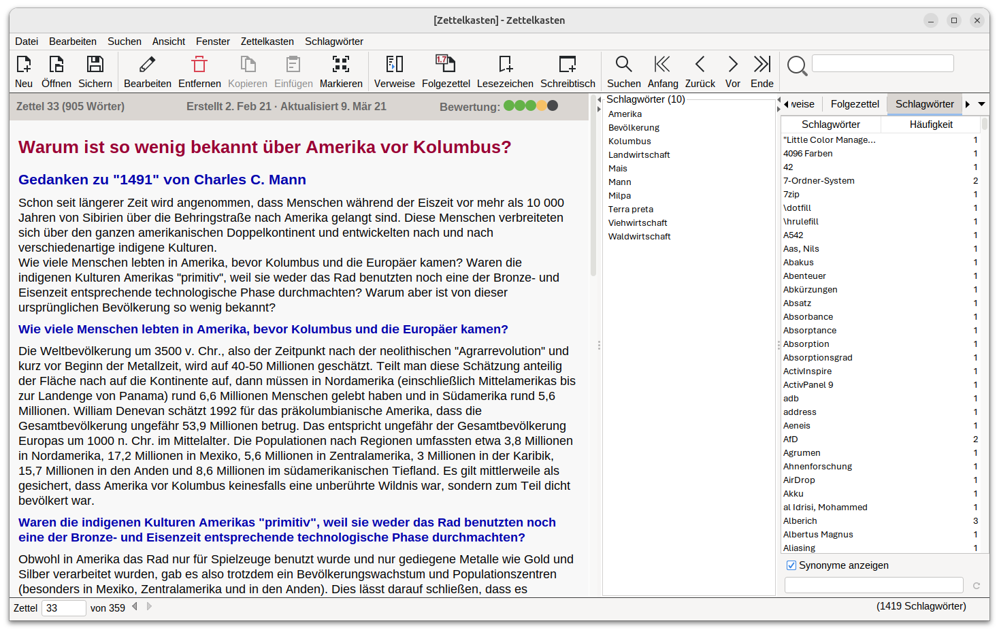

# My Personal Edition of Zettelkasten

## "Zettelkasten MPE"


<p>
    <a href="https://github.com/Zettelkasten-Team/Zettelkasten/releases" alt="Release">
        
    </a>
     <a href="https://github.com/Zettelkasten-Team/Zettelkasten/releases" alt="Downloads">
        
     </a>
     <a href="https://github.com/Zettelkasten-Team/Zettelkasten/issues" alt="Resolution time">
        
    </a>
     <a href="https://github.com/Zettelkasten-Team/Zettelkasten/issues" alt="Open Issues">
        
     </a>
    <a href="https://github.com/Zettelkasten-Team/Zettelkasten/graphs/contributors" alt="Contributors">
        
    </a>
    
</p>


My Personal Edition of Zettelkasten ("Zettelkasten MPE") is based on  the application Zettelkasten Zkn3 conceived and written in most parts by Daniel Lüdecke.  The Zettelkasten app Zkn3 is inspired by the note-taking system of Niklas Luhmann. With the Zettelkasten app Zkn3 you can create and edit notes with attachments, annotations and BibTeX-references. You can link and tag your notes, you can search them and you can connect them to outlines editable in LaTeX, LibreOffice Writer or Microsoft Word. Notes with a meaning for more than one subject are linked to each subject, there is no redundancy and no need to decide between subjects.

I use the Zettelkasten app Zkn3 since the beginning of 2020. However, after a while, certain shortcomings of the Zettelkasten app Zkn3 on Ubuntu Linux with Gnome desktop regarding appearance of fonts and visual integration put me on the track of ways to overcome these issues. Apart from outer appearance I wanted an improved export to HTML and to the native document formats of LibreOffice Writer and Microsoft Word. Zettelkasten MPE is the result, which I like to share here.


*Zettelkasten main window on Ubuntu with FlatLightLaf and Breeze icons*

## Download

Find the latest release [here](https://github.com/THgithub19/Zettelkasten/releases).

## Zettelkasten Build

To build Zettelkasten, you need a Java Development Kit (JDK) 8 and Maven 3.

To get a local repository, use Git:

```shell
git clone git@github.com/THgithub19/Zettelkasten.git
```

Then, in the root directory of the local repository, run the following command line:

```shell
mvn clean package
```
Note: `mvn` is [Apache Maven](https://maven.apache.org/install.html). Confirm with `mvn -v` in a new shell.

Find the build result in your `target` directory.


## License

The GPLv3 applies. For detail information see LICENSE.md
