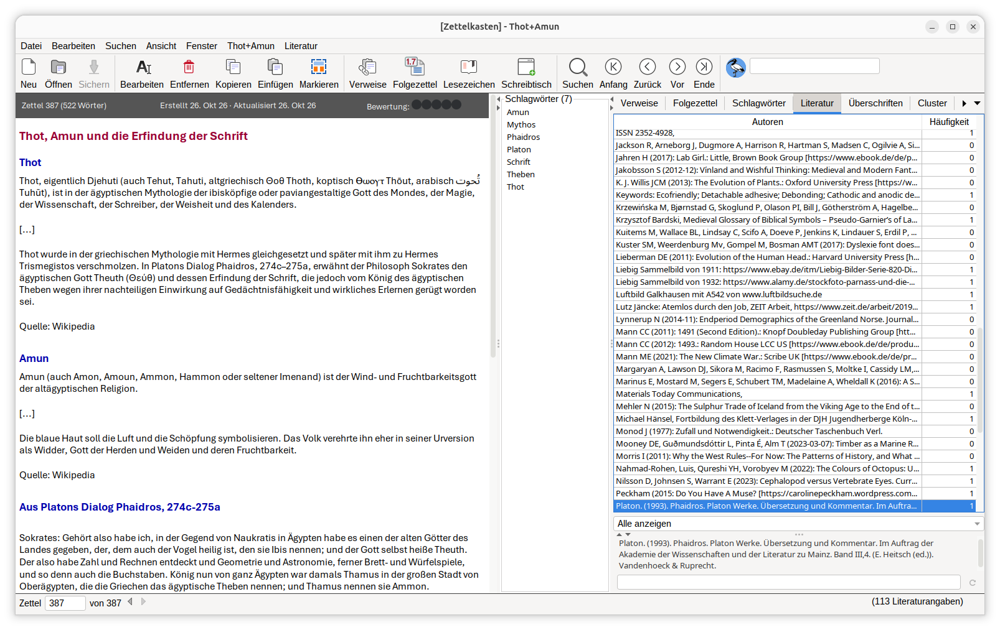

# Thot+Amun

## Personal Note and Knowledge Organizer


Thot+Amun (just say "Thot ['and' in your language] Amun") is for everybody who collects and reuses knowledge fixed in notes.  Use it for scientific projects, to prepare lessons for school, to store and and explore genealogic data, to browse through collections of recipes or lyrics, to keep track of thoughts and many more conceivable purposes.  The name Thot+Amun refers to the discourse of the Egyptian gods Thot and Amun on the impact of writing on humans, passed down in Platons dialogue Phaidros.

Thot+Amun allows you to create, edit and collect notes with attachments, annotations and references. With Thot+Amun, you can link and tag notes in your collection, and you can connect and export notes to outlines editable in LaTeX, LibreOffice or Microsoft Word. Thot+Amun features sophisticated functions to search for specific notes as well as for sets of notes sharing subjects. Notes with a meaning for more than one subject are linked to each subject, so there is not redundancy and no need to decide between subjects. Thot+Amun stores all your data just where you want to have them. Thot+Amun uses standard formats only, so your data are not locked in. 

Thot+Amun is a fork of the Zettelkasten app Zkn3 conceived and developed in most parts by Daniel Lüdecke. During a phase of stagnant Zkn3 development, certain shortcomings on Ubuntu Linux with Gnome desktop regarding appearance of fonts and visual integration put me on the track of ways to overcome these issues. Additionally, a system of help and howtos was introduced to explain the many features of the app. Visual formatting on export to HTML was reduced allowing for better editable documents for LibreOffice Writer and Microsoft Word. 


*Thot+Amun main window on Ubuntu with FlatLightLaf and Yaru icons*

## Download

Find the latest release [here](https://github.com/THgithub19/Zettelkasten/releases).

## Thot+Amun Build

To build Thot+Amun, you need a Java Development Kit (JDK) 8 or above and Maven 3.

To get a local repository, use Git:

```shell
git clone git@github.com/THgithub19/Zettelkasten.git
```

Then, in the root directory of the local repository, run the following command line:

```shell
mvn clean package
```
Note: `mvn` is [Apache Maven](https://maven.apache.org/install.html). Confirm with `mvn -v` in a new shell.

Find the build result in your `target` directory.


## License

The GPLv3 applies. For detail information see LICENSE.md
